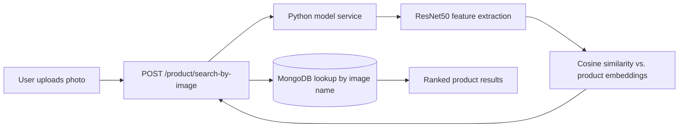
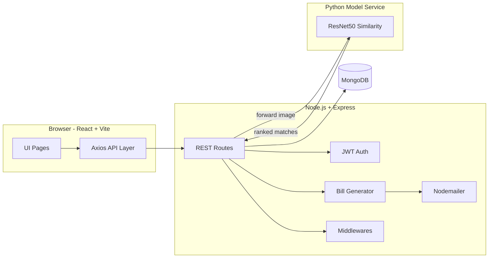

<div align="center">

# 🛍 AI Commerce

### An AI-powered clothing store where you search with an image, not a keyboard.

**Full-stack e-commerce platform with computer-vision product search, real-time cart, JWT auth, and automated billing.**

[](https://react.dev)
[](https://nodejs.org)
[](https://mongodb.com)
[](https://python.org)
[](https://pytorch.org)
[](https://jwt.io)

</div>

---

## 👋 What this is

AI Commerce is a full-stack e-commerce platform I built to explore a question that kept bugging me:

> *"What if you could just show the store a picture of what you want, and it finds it?"*

The result is a working clothing store with:

- 🖼 **Image-based product search** — upload a photo, get visually similar products back, ranked by similarity. Powered by a **ResNet50** model that extracts feature vectors from every product image.
- 🛒 **Complete shopping flow** — browse, filter by category/price, add to cart, checkout.
- 📧 **Automated email bills** — every purchase triggers an HTML email receipt generated server-side.
- 🔐 **JWT authentication** — signup, login, password recovery via email verification code.
- 👑 **Role-based access** — customers, admins, and a manager role that can promote/demote admins.
- ⚡ **Real-time stock updates** — quantities are decremented atomically on purchase.
- 🌍 **Country/city picker** — location data loaded from a bundled dataset.

Every line is mine. Frontend, backend, AI integration, database design.

[🎥 Watch the  demo →](https://onedrive.live.com/?qt=allmyphotos&photosData=%2Fshare%2FCA524006C0AC4FC8%21s68b1fea510e5405a97537d9fe6745ec8%3Fithint%3Dvideo%26e%3DrEvwAF%26migratedtospo%3Dtrue&cid=CA524006C0AC4FC8&id=CA524006C0AC4FC8%21s68b1fea510e5405a97537d9fe6745ec8&redeem=aHR0cHM6Ly8xZHJ2Lm1zL3YvYy9jYTUyNDAwNmMwYWM0ZmM4L0VhWC1zV2psRUZwQWwxTjluLVowWHNnQnBpQ2NORXlxYlFCUndJZkppcmRlQmc%5FZT1yRXZ3QUY&v=photos)

---

## 🧠 How the image search works

This is the part that makes the project interesting.



**The pipeline, step by step:**

1. The user drops a photo into the search bar. The browser posts it to `/product/search-by-image` as multipart form-data.
2. The Node backend saves the file temporarily and forwards it to a separate Python service (`SIMILARITY_URL`).
3. The Python service runs the image through a pre-trained **ResNet50** (via PyTorch/TensorFlow) to extract a feature vector.
4. It compares that vector against the embeddings of every product image in the catalog using **cosine similarity**.
5. It returns a ranked list of the closest matches.
6. The backend maps those image filenames back to product documents in MongoDB and returns the full product info.

**Why ResNet50?** It's a deep CNN trained on ImageNet. The penultimate layer produces a 2048-dimensional embedding that captures visual features like color, texture, and shape — exactly what you need for "find me something that looks like this."

**The design decision:** I kept the ML service **completely separate** from the Node backend. The backend doesn't know or care how the similarity is computed — it just sends a file and gets back a ranked list. That means I can swap ResNet50 for CLIP or any other model without touching a single line of the app.

---

## 🏗 Architecture



**Design decisions I made deliberately:**

| Choice | Why |
|---|---|
| **Separate Python ML service** | Decouples model inference from the API. Swap models without redeploying Node. |
| **JWT over sessions** | Stateless auth is simpler for a SPA and works cleanly with the API-first design. |
| **Middleware pattern** | `authentication.js`, `productMiddleware.js`, `billMiddleware.js`, `userMiddleware.js` — each handles one concern. Controllers stay thin. |
| **Custom error handler** | `throwError(message, status)` + `handleError(err, res)` — consistent HTTP responses without repeating try/catch logic everywhere. |
| **Atomic quantity decrement** | Stock is decremented *before* the bill is saved. If anything fails, the transaction is rejected. |
| **Server-side bill HTML** | The bill email is generated on the server, not the client. The client can't tamper with the receipt. |

---

## 🛠 Tech Stack

| Layer | Technologies |
|---|---|
| **Frontend** | React 18, Vite, React Router, TailwindCSS, Axios, js-cookies |
| **Backend** | Node.js, Express, Mongoose, Multer, Nodemailer, bcryptjs, jsonwebtoken |
| **AI Service** | Python, ResNet50 (feature extraction), cosine similarity |
| **Database** | MongoDB (via Mongoose) |
| **Auth** | JWT (custom implementation, no Passport) |

---

## 🔌 API Overview

<details>
<summary><b>Product routes — <code>/api/product</code></b></summary>

| Method | Endpoint | Purpose |
|---|---|---|
| `POST` | `/` | Create product (admin/manager only) |
| `GET` | `/` | List/filter products (search, category, min/max price) |
| `GET` | `/:productId` | Get one product |
| `GET` | `/get-random-products?batch=N` | Paginated random products |
| `GET` | `/get-image?productId=&imageName=` | Serve a product image |
| `PATCH` | `/` | Update product |
| `DELETE` | `/` | Soft-delete (sets quantity to 0) |
| `POST` | `/search-by-image` | **Image search** — the AI pipeline |

</details>

<details>
<summary><b>User routes — <code>/api/user</code></b></summary>

| Method | Endpoint | Purpose |
|---|---|---|
| `POST` | `/` | Create account |
| `GET` | `/login` | Login (returns JWT) |
| `GET` | `/validate-token` | Verify JWT |
| `GET` | `/recover-account?email=` | Send verification code |
| `POST` | `/recover-account` | Verify code |
| `PATCH` | `/reset-password` | Reset password |
| `POST` | `/buy` | Checkout (creates bill + sends email) |
| `GET` | `/get-admins` | List admins |
| `PATCH` | `/toggle-admin` | Promote/demote admin |
| `GET` | `/get-countries` / `/get-cities` | Location data |

</details>

---

## 🚀 Run it locally

### Prerequisites
- **Node.js** ≥ 18
- **MongoDB** running on `localhost:27017`
- **Python 3.10+** (only if you want the image search to work)

### 1. Backend

```bash
cd server
npm install
```

Create `server/.env`:

```env
PORT=3000
MONGO_URI=mongodb://127.0.0.1:27017/ai-commerce

JWT_SECRET=your_random_secret_here

# Email (Gmail app password)
EMAIL=your_email@gmail.com
UESR_NAME=your_email@gmail.com
APP_PASSWORD=your_16_char_app_password

# Python similarity service
SIMILARITY_URL=http://127.0.0.1:5001/similarity
SERVER_TOKEN=any_shared_token

# Manager account (for the admin toggle feature)
MANAGER_PASSWORD=your_manager_password
MANAGER_ID=<a_mongodb_user_id>
```

Start the backend:

```bash
node index.js
```

### 2. Frontend

```bash
cd browser
npm install
npm run dev
```

Opens at **http://localhost:5173**.

### 3. Python similarity service (optional)

```bash
cd ml_service
pip install -r requirements.txt
python app.py
```

Without this service running, everything works **except** the image search — the API will return an error when you try to upload a photo.

---

## 🎥 Demo

Full walkthrough (signup → browse → image search → checkout → email bill):

[🎥 Watch the demo](https://onedrive.live.com/?qt=allmyphotos&photosData=%2Fshare%2FCA524006C0AC4FC8%21s68b1fea510e5405a97537d9fe6745ec8%3Fithint%3Dvideo%26e%3DrEvwAF%26migratedtospo%3Dtrue&cid=CA524006C0AC4FC8&id=CA524006C0AC4FC8%21s68b1fea510e5405a97537d9fe6745ec8&redeem=aHR0cHM6Ly8xZHJ2Lm1zL3YvYy9jYTUyNDAwNmMwYWM0ZmM4L0VhWC1zV2psRUZwQWwxTjluLVowWHNnQnBpQ2NORXlxYlFCUndJZkppcmRlQmc%5FZT1yRXZ3QUY&v=photos)

---

## 🚧 What I'd do differently in production

| Limitation | The fix |
|---|---|
| **No bcrypt on signup** | Passwords are hashed in one place but not consistently. Centralize hashing in a user middleware. |
| **Plain HTTP for the ML service** | Should use HTTPS + mTLS between Node and Python. |
| **No rate limiting** | Add `express-rate-limit` on auth and search endpoints. |
| **No tests** | The bill calculator and quantity checker especially need unit tests. |
| **Image storage on disk** | Move to S3 or Cloudflare R2 with signed URLs. |
| **ResNet50 is heavy** | A distilled model (MobileNet, CLIP ViT-B/32) would be faster and nearly as accurate. |
| **`index.js` has a bug** | `io` is referenced before declaration. Fix and add a smoke test. |
| **Secrets in `.env`** | Already gitignored, but production would use a secrets manager. |

Being honest about these is more useful than pretending the project is perfect.

---

## 🧗 What I learned

- Building a **full e-commerce flow** from product listing to automated billing
- **Integrating a Python ML service** into a Node.js backend without coupling them
- Designing a **clean middleware layer** for auth, validation, and error handling
- **JWT authentication** implemented from scratch (no Passport, no shortcuts)
- Managing **file uploads** with Multer and serving them securely
- Generating **server-side HTML emails** with Nodemailer
- **Role-based access control** with a hierarchy of customer → admin → manager

---

## 📬 About me

I'm **Sami Khaleel** — a full-stack developer based in Jülich, NRW, Germany.

I build things end-to-end: React on the front, Node on the back, Python when the problem needs it. I'm available immediately and open to **Junior Full-Stack Developer** roles in NRW or remote.

- 📧 **Email:** sami000khaleel@gmail.com
- 🐙 **GitHub:** [@sami000khaleel](https://github.com/sami000khaleel)
- 📍 **Location:** Jülich, NRW

[🎥 Watch the demo](https://onedrive.live.com/?qt=allmyphotos&photosData=%2Fshare%2FCA524006C0AC4FC8%21s68b1fea510e5405a97537d9fe6745ec8%3Fithint%3Dvideo%26e%3DrEvwAF%26migratedtospo%3Dtrue&cid=CA524006C0AC4FC8&id=CA524006C0AC4FC8%21s68b1fea510e5405a97537d9fe6745ec8&redeem=aHR0cHM6Ly8xZHJ2Lm1zL3YvYy9jYTUyNDAwNmMwYWM0ZmM4L0VhWC1zV2psRUZwQWwxTjluLVowWHNnQnBpQ2NORXlxYlFCUndJZkppcmRlQmc%5FZT1yRXZ3QUY&v=photos)

---

<div align="center">

**⭐ If you found this project interesting, feel free to star it.**

</div>
